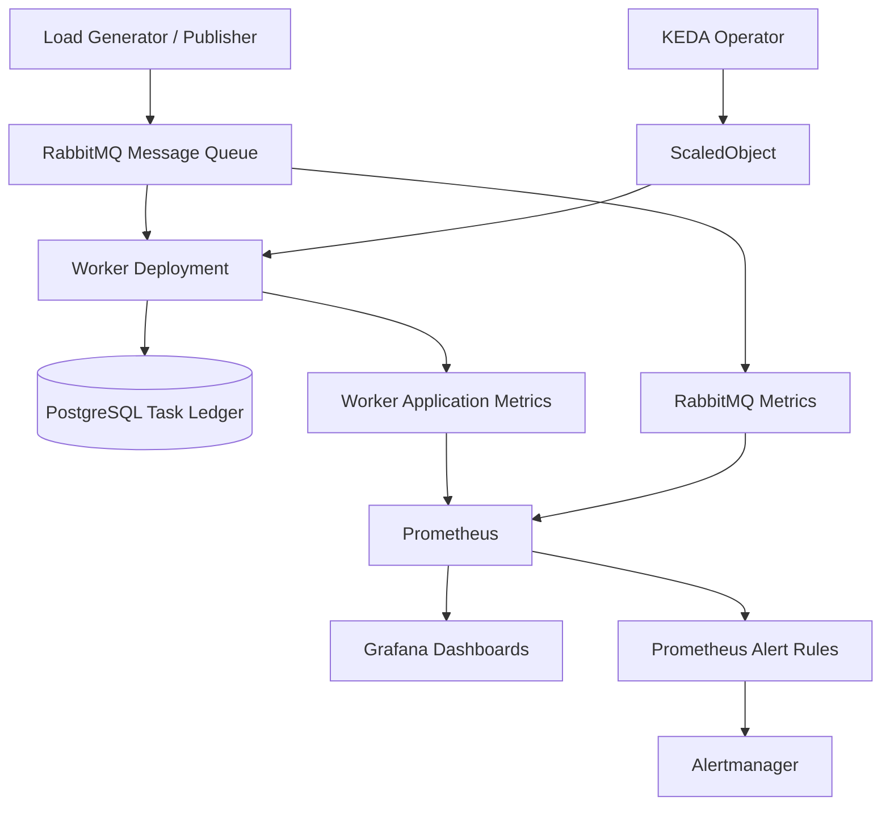

# 🚀 Event-Driven Autoscaling on Kubernetes with KEDA, RabbitMQ & Prometheus

### SRE | Kubernetes | Observability | Reliability Engineering

[](https://kubernetes.io/)
[](https://keda.sh/)
[](https://www.rabbitmq.com/)
[](https://prometheus.io/)
[](https://grafana.com/)
[](https://www.postgresql.org/)

## 📌 Project Overview

This project demonstrates how to build and monitor an event-driven, autoscaling worker system on Kubernetes.

The system uses **RabbitMQ** as a message broker, **KEDA** to scale Kubernetes worker pods based on queue demand, **Prometheus** to collect metrics, **Grafana** to visualize system behavior, and **PostgreSQL** to maintain durable task records.

The objective is to explore practical Site Reliability Engineering (SRE) concepts, including:

- Event-driven autoscaling and workload management.
- Monitoring incoming, processed, and failed tasks.
- Observability through metrics and dashboards.
- Alerting for operational issues.
- Durable task accounting beyond individual pod lifetimes.
- Troubleshooting distributed application workloads.

This is a hands-on learning project developed and tested in a local Minikube environment.

## 🎯 Project Goals

The project focuses on answering real operational questions:

- Can worker capacity increase automatically when message traffic grows?
- Can the system scale down after the workload is processed?
- How can we identify a growing queue backlog?
- How can we measure processing throughput and failures?
- How can we preserve task totals when Kubernetes replaces or deletes worker pods?
- How can monitoring and alerts help identify potential reliability issues?

## 🏗️ Architecture



### How It Works

1. A publisher generates tasks and sends them to the RabbitMQ queue.
2. RabbitMQ buffers messages until workers are ready to process them.
3. KEDA monitors the configured queue metric and adjusts the worker replica count through Kubernetes autoscaling.
4. Worker pods consume messages and record task outcomes.
5. PostgreSQL stores task-level records for durable accounting.
6. Prometheus collects application and RabbitMQ metrics.
7. Grafana visualizes workload activity, processing throughput, and system behavior.
8. Prometheus alert rules and Alertmanager provide an alerting workflow for configured operational conditions.

## 🛠️ Technology Stack

| Technology | Purpose |
|---|---|
| Kubernetes | Container orchestration |
| Minikube | Local Kubernetes development and testing |
| KEDA | Event-driven workload autoscaling |
| RabbitMQ | Message queuing and asynchronous communication |
| Python | Worker application and workload generation |
| Docker | Container image creation and packaging |
| Prometheus | Metrics collection and querying |
| Grafana | Monitoring dashboards and visualization |
| Prometheus Operator | Management of monitoring resources |
| Alertmanager | Alert grouping, routing, and notification integration |
| PostgreSQL | Persistent task records and status tracking |
| kubectl | Kubernetes resource management |

## ⚙️ Key Features

### 1. Event-Driven Autoscaling with KEDA

The worker application scales according to message queue demand rather than relying exclusively on CPU utilization.

Key areas explored:

- KEDA ScaledObjects and RabbitMQ scaling configuration.
- Kubernetes Horizontal Pod Autoscaler integration.
- Automatic scale-out during workload spikes.
- Scale-in after demand decreases.
- Minimum and maximum replica configuration.
- Validation using `kubectl get hpa` and `kubectl get scaledobjects`.

Example validation:

```bash
kubectl get scaledobjects -n messaging
kubectl describe scaledobject -n messaging <scaledobject-name>
kubectl get hpa -n messaging
kubectl get deployment task-worker -n messaging -w
```

**Expected result:** worker replicas increase when the configured scaling conditions are met and can decrease when demand subsides, subject to the KEDA and HPA configuration.

### 2. RabbitMQ Message Processing

RabbitMQ decouples task publishing from task execution.

This helps demonstrate:

- Asynchronous task processing.
- Queue-based workload buffering.
- Producer and consumer separation.
- Message acknowledgements.
- Processing failures and retries.
- Queue backlog monitoring.

RabbitMQ metrics help investigate whether tasks are being published, delivered, acknowledged, or accumulating in the queue.

### 3. Prometheus Monitoring

Prometheus collects metrics from the worker application and RabbitMQ.

Application-level metrics include:

- `worker_messages_received_total`
- `worker_messages_processed_total`
- `worker_messages_failed_total`

RabbitMQ metrics can provide additional information about published messages, acknowledged messages, and queue activity.

Metric availability depends on the exporter and configuration. Verify exact names in the Prometheus expression browser.

### 4. Grafana Dashboards

Grafana provides a visual view of application and messaging behavior.

The monitoring workflow can be used to investigate:

- Incoming task activity.
- Successfully processed tasks.
- Failed tasks.
- Processing throughput over time.
- RabbitMQ message activity.
- Worker scaling behavior.
- Potential differences between incoming and processed workload.

The aim is to make system behavior easier to understand during normal operation and workload spikes.

### 5. Durable Task Accounting with PostgreSQL

Prometheus counters are useful for monitoring, but they should not be treated as a permanent business ledger.

When a worker pod is deleted, its individual counter series may disappear or become unavailable. Counter resets, scrape gaps, and retention limits can also affect historical queries.

To address this limitation, the project uses PostgreSQL to maintain task-level records and outcomes.

The ledger can support queries for:

- Total recorded tasks.
- Successfully processed tasks.
- Failed tasks.
- Pending or in-progress tasks.

For reliable totals, task records should use unique task IDs, appropriate database constraints, and idempotent update logic.

**Design principle:** use Prometheus for observability and PostgreSQL for durable task accounting.

### 6. Prometheus Alerting

The project also explores Prometheus alert rules and Alertmanager integration.

Potential alert scenarios include:

- Worker replica count exceeding an expected threshold.
- RabbitMQ queue backlog remaining elevated.
- Processing failures increasing.
- Worker processing activity stopping unexpectedly.
- Monitoring targets becoming unavailable.

Alert thresholds should be tuned to the workload. A high replica count or queue depth is a signal to investigate, not necessarily an incident on its own.

## 📊 Useful PromQL Queries

Run these queries in Prometheus after confirming that the corresponding metrics exist.

### Total messages received

```promql
sum(worker_messages_received_total)
```

### Total messages processed

```promql
sum(worker_messages_processed_total)
```

### Total failed messages

```promql
sum(worker_messages_failed_total)
```

### Incoming message rate

```promql
sum(rate(worker_messages_received_total[5m]))
```

### Successful processing rate

```promql
sum(rate(worker_messages_processed_total[5m]))
```

### Failure rate

```promql
sum(rate(worker_messages_failed_total[5m]))
```

### Incoming versus processed rate difference

```promql
sum(rate(worker_messages_received_total[5m]))
-
sum(rate(worker_messages_processed_total[5m]))
```

This query compares rates; it does not directly measure the RabbitMQ queue backlog. For the actual backlog, use the appropriate RabbitMQ ready-message metric.

### RabbitMQ acknowledged messages

If this metric and label set exist in your installation:

```promql
sum(rabbitmq_queue_messages_acked_total{namespace="messaging"})
```

**Important:** these Prometheus queries are useful for trends and operational monitoring. For durable all-time totals across deleted pods, query the PostgreSQL task ledger instead.

## 🧪 Testing and Validation

The project can be validated using a gradual workload rather than publishing every task at once.

### Test 1: Baseline

Check the initial state:

```bash
kubectl get pods -n messaging
kubectl get deployment task-worker -n messaging
kubectl get hpa -n messaging
kubectl get scaledobjects -n messaging
```

Record the initial replica count and queue depth.

### Test 2: Generate workload

Run the project's load generator and publish tasks gradually.

Observe the worker replica count:

```bash
kubectl get deployment task-worker -n messaging -w
```

Also monitor queue activity and worker processing metrics in Prometheus.

### Test 3: Observe scale-out

Confirm that the queue scaling trigger responds to demand and that worker replicas increase within configured limits.

### Test 4: Observe scale-in

Stop publishing new tasks and allow the queue to drain.

Check whether replicas decrease according to the configured cooldown and scaling behavior.

### Test 5: Validate task totals

Compare application metrics with the durable PostgreSQL task records.

Investigate discrepancies by checking retries, duplicate deliveries, task IDs, acknowledgement behavior, and failure handling.

### Test 6: Validate alerts

Confirm that Prometheus loads the intended alert rules and that Alertmanager receives alerts when their conditions are met.

## 🔍 Troubleshooting

| Problem | Investigation |
|---|---|
| Worker replicas do not increase | Inspect the ScaledObject, HPA conditions, KEDA logs, queue metrics, and authentication configuration |
| RabbitMQ pod restarts | Review pod events, logs, readiness/liveness probes, resource limits, and available memory |
| Worker image pull fails | Verify image tag, registry access, image pull secret, and TLS configuration |
| Prometheus metrics are missing | Check target health, ServiceMonitor selectors, service labels, and scrape configuration |
| Grafana panels show no data | Run the PromQL query directly in Prometheus and verify labels and time range |
| Task totals differ from metrics | Compare unique task IDs, ledger statuses, retries, and acknowledgement behavior |
| Alerts do not fire | Inspect PrometheusRule selection, rule evaluation, threshold, duration, and Alertmanager routing |

Useful commands:

```bash
kubectl get events -n messaging --sort-by=.lastTimestamp
kubectl get pods -n messaging
kubectl logs -n messaging <pod-name>
kubectl describe pod -n messaging <pod-name>
kubectl get servicemonitors -A
kubectl get prometheusrules -A
```

## 🔐 Reliability and Security Considerations

This project also provides an opportunity to practice important SRE principles:

- Use Kubernetes Secrets or a suitable secret manager for credentials.
- Avoid committing passwords, tokens, or private configuration to Git.
- Configure appropriate resource requests and limits.
- Use readiness and liveness probes that reflect actual application health.
- Make task processing idempotent.
- Define clear retry, acknowledgement, and dead-letter behavior.
- Monitor queue depth, processing rate, failures, and processing latency.
- Use database constraints to protect task accounting from duplicate records.
- Plan persistent storage, backups, recovery testing, TLS, and access control before production deployment.

The current project is a local Minikube learning environment. It does not claim production-grade high availability or a measured service-level objective (SLO).

## 📚 What I Learned

Through this project, I explored:

- Event-driven autoscaling using KEDA and RabbitMQ.
- Kubernetes Deployments, HPA behavior, and scaling validation.
- Application observability using Prometheus and Grafana.
- PromQL queries for rates, counters, and workload analysis.
- Prometheus alert rules and Alertmanager workflows.
- Durable task accounting using PostgreSQL.
- Troubleshooting Kubernetes workloads and monitoring integrations.
- The difference between application metrics and durable business records.
- Reliability concerns around retries, duplicate delivery, failures, and queue backlogs.

## 🚀 Future Improvements

- Add automated tests for worker restarts and duplicate message delivery.
- Define SLOs for task success rate and processing latency.
- Add alerts for sustained queue growth and lack of processing progress.
- Test RabbitMQ and PostgreSQL recovery and backup restoration.
- Add CI checks for Kubernetes manifests, image vulnerabilities, and secret leaks.
- Expand testing to a multi-node or managed Kubernetes cluster.
- Document resource sizing and scaling behavior under different workloads.

## 📖 References

- [KEDA Documentation](https://keda.sh/docs/latest/)
- [KEDA RabbitMQ Queue Scaler](https://keda.sh/docs/latest/scalers/rabbitmq-queue/)
- [Kubernetes Documentation](https://kubernetes.io/docs/)
- [Prometheus Documentation](https://prometheus.io/docs/)
- [Grafana Documentation](https://grafana.com/docs/)
- [RabbitMQ Documentation](https://www.rabbitmq.com/docs)
- [PostgreSQL Documentation](https://www.postgresql.org/docs/)

## 👨‍💻 Author

Built as a hands-on project to strengthen my skills in **Kubernetes, SRE, DevOps, observability, and platform engineering**.

Feedback and suggestions are welcome!

If you find this project useful, please ⭐ the repository.
