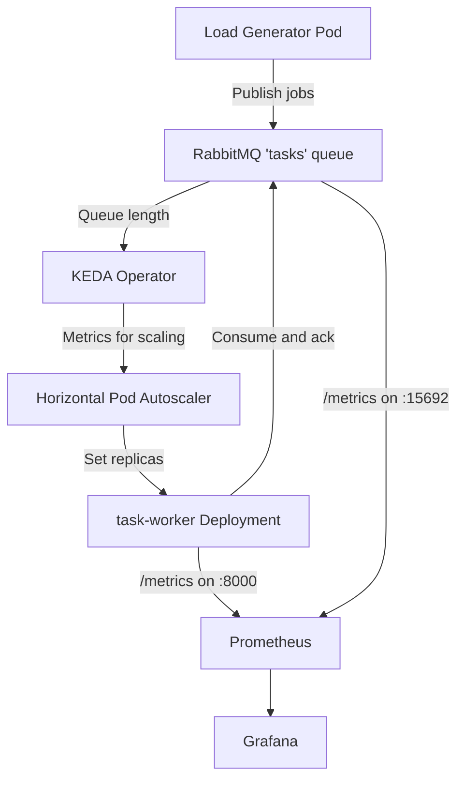

# KEDA-Based RabbitMQ Autoscaling on Kubernetes

A hands-on Kubernetes project that demonstrates **event-driven autoscaling** with **KEDA**, **RabbitMQ**, **Prometheus**, and **Grafana**. A load generator publishes tasks to a RabbitMQ queue, and KEDA scales a pool of Python worker pods based on how many messages are waiting, not on CPU or memory.

## Why Queue-Based Autoscaling?

CPU-based autoscaling reacts after workers are already busy. For background job processing, the real signal is the backlog: if 500 jobs are waiting, you need more workers now, even if the current pods look idle. KEDA reads the RabbitMQ queue length and feeds that number into the Kubernetes Horizontal Pod Autoscaler (HPA), which then adjusts the replica count.

## Architecture



### Components

| Component | Kubernetes object | Role |
|---|---|---|
| Load generator | `Pod` (`load-generator`) | Publishes jobs to the `tasks` queue in four load phases |
| RabbitMQ | `Deployment`, `Service`, `PVC` (`rabbitmq`) | Stores jobs durably and delivers them to workers |
| Worker | `Deployment` (`task-worker`) | Consumes jobs, simulates 5 seconds of work per job, exposes metrics |
| KEDA `ScaledObject` | `task-worker-scaler` | Watches the queue and drives the HPA for `task-worker` |
| KEDA `TriggerAuthentication` | `rabbitmq-trigger-auth` | Gives KEDA the RabbitMQ connection string from a Secret |
| Metrics Service | `task-worker-metrics` | Exposes worker port 8000 for Prometheus |
| ServiceMonitors | `rabbitmq`, `task-worker` (in `monitoring`) | Tell Prometheus which endpoints to scrape |

## How It Works

1. The **load generator** publishes messages (`job-1`, `job-2`, ...) to the durable `tasks` queue through the default exchange.
2. **RabbitMQ** holds the messages until a worker acknowledges them.
3. **KEDA** polls the queue every 15 seconds using its RabbitMQ scaler, in `QueueLength` mode with a target of 5 messages per replica.
4. KEDA converts the queue length into a desired replica count and creates or updates an HPA for the `task-worker` Deployment.
5. The **HPA** scales `task-worker` between `minReplicaCount: 1` and `maxReplicaCount: 10`.
6. Each **worker** takes one message at a time (`prefetch_count=1`), processes it, and sends a manual `ack`. On failure it sends a `nack` with requeue.
7. The **worker** increments Prometheus counters for received, processed, and failed messages, and records processing time in a histogram.
8. **Prometheus** scrapes the worker and RabbitMQ metrics. **Grafana** visualizes throughput, backlog, and replica count.

### Load Profile

The load generator runs four phases, each 90 seconds long:

| Phase | Publish interval | Approximate rate |
|---|---|---|
| NORMAL | 3 s | ~0.33 jobs/s |
| INCREASING | 2 s | ~0.5 jobs/s |
| HEAVY | 1 s | 1 job/s |
| NORMAL | 3 s | ~0.33 jobs/s |

Each worker needs about 5 seconds per job, so one worker handles roughly 0.2 jobs/s. During the HEAVY phase the queue grows faster than one worker can drain it, and KEDA adds replicas. When the load drops and the backlog clears, the replica count falls back toward the minimum.

## Technology Stack

| Technology | Purpose |
|---|---|
| Kubernetes | Container orchestration |
| Minikube | Local single-node cluster |
| KEDA | Event-driven autoscaling (ScaledObject, TriggerAuthentication) |
| Kubernetes HPA | Applies the replica count that KEDA computes |
| RabbitMQ 4.1 (management image) | Message broker and durable task queue |
| Python 3.12, Pika 1.3.2 | Worker and load generator |
| prometheus-client 0.23.1 | Custom worker metrics |
| Docker | Packages the worker image |
| kube-prometheus-stack | Prometheus Operator, Prometheus, Grafana |

## Repository Layout

```text
keda-rabbitmq-project/
├── README.md
├── app/
│   ├── worker.py                     # Consumer + Prometheus metrics
│   └── Dockerfile                    # python:3.12-slim, non-root user 10001
└── k8s/
    ├── namespace.yaml                # 'messaging' namespace
    ├── rabbitmq.yaml                 # PVC, RabbitMQ Deployment, Service
    ├── rabbitmq-secret.yaml          # rabbitmq-credentials Secret
    ├── docker-secret.yaml            # docker-rs image pull Secret
    ├── worker.yaml                   # task-worker Deployment
    ├── task-worker-service.yaml      # task-worker-metrics Service (port 8000)
    ├── keda-autoscaling.yaml         # TriggerAuthentication, scaler Secret, ScaledObject
    ├── load-generator.yaml           # Load generator Pod
    ├── rabbitmq-servicemonitor.yaml  # Scrapes RabbitMQ (port 15692)
    └── monitoring/
        └── task-worker-servicemonitor.yaml  # Scrapes task-worker (port 8000)
```

## Prerequisites

- Docker
- Minikube and kubectl
- Helm (for KEDA and kube-prometheus-stack)
- A container registry reachable from the cluster nodes
- Basic familiarity with Deployments, Services, Secrets, and YAML

## Deployment Guide

Run all commands from the `keda-rabbitmq-project` directory.

### Step 1: Start the Cluster

```bash
minikube start
kubectl get nodes
```

### Step 2: Install KEDA

Follow the official guide at https://keda.sh/docs/latest/deploy/, then verify:

```bash
kubectl get pods -n keda
kubectl get crd | grep keda
```

Confirm that the `ScaledObject` and `TriggerAuthentication` CRDs are listed.

### Step 3: Install Monitoring (Optional but Recommended)

Install `kube-prometheus-stack` into the `monitoring` namespace. The ServiceMonitors in this project use the label `release: monitoring`, so the Helm release must be named `monitoring`:

```bash
helm repo add prometheus-community https://prometheus-community.github.io/helm-charts
helm repo update
helm install monitoring prometheus-community/kube-prometheus-stack -n monitoring --create-namespace
```

### Step 4: Create the Namespace and Secrets

```bash
kubectl apply -f k8s/namespace.yaml
kubectl apply -f k8s/rabbitmq-secret.yaml
kubectl apply -f k8s/docker-secret.yaml
```

Supply real credentials through these Secrets or through your own secret-management process. Do not commit real passwords to the repository.

### Step 5: Deploy RabbitMQ

```bash
kubectl apply -f k8s/rabbitmq.yaml
kubectl apply -f k8s/rabbitmq-servicemonitor.yaml
kubectl get pods -n messaging -w
```

Wait until the `rabbitmq` pod is `Running` and `Ready`. RabbitMQ listens on `5672` (AMQP), `15672` (management UI), and `15692` (Prometheus metrics).

### Step 6: Build and Push the Worker Image

```bash
docker build -t myregistry.com:5000/keda-rabbitmq-worker:2.0 app/
docker push myregistry.com:5000/keda-rabbitmq-worker:2.0
```

The Kubernetes nodes must be able to pull from the registry. The `docker-rs` Secret provides the pull credentials.

### Step 7: Deploy the Worker

```bash
kubectl apply -f k8s/worker.yaml
kubectl apply -f k8s/task-worker-service.yaml
kubectl apply -f k8s/monitoring/task-worker-servicemonitor.yaml
kubectl get deployment task-worker -n messaging
kubectl logs -n messaging deployment/task-worker
```

The logs should show `Prometheus metrics available on port 8000` and `Worker ready; waiting for jobs`.

The worker reads these environment variables:

| Variable | Source | Purpose |
|---|---|---|
| `RABBITMQ_HOST` | Literal in `worker.yaml` | `rabbitmq.messaging.svc.cluster.local` |
| `RABBITMQ_USER` / `RABBITMQ_PASSWORD` | `rabbitmq-credentials` Secret | Broker login |
| `QUEUE_NAME` | Literal in `worker.yaml` | `tasks` |

### Step 8: Enable KEDA Autoscaling

```bash
kubectl apply -f k8s/keda-autoscaling.yaml
kubectl get scaledobject -n messaging
kubectl get hpa -n messaging
```

This file creates three objects:

- **`TriggerAuthentication` `rabbitmq-trigger-auth`** reads the `connection` key from a Secret and gives it to the RabbitMQ scaler as `host`.
- **Secret `rabbitmq-scaler-connection`** holds an AMQP connection string (`amqp://<user>:<password>@rabbitmq.messaging.svc.cluster.local:5672/`).
- **`ScaledObject` `task-worker-scaler`** targets the `task-worker` Deployment with these settings:

| Setting | Value | Meaning |
|---|---|---|
| `pollingInterval` | 15 s | How often KEDA checks the queue |
| `cooldownPeriod` | 60 s | Wait time before scaling down (applies to scale-to-zero) |
| `minReplicaCount` / `maxReplicaCount` | 1 / 10 | Replica bounds |
| `fallback` | 2 replicas after 3 failed checks | Keeps workers running if KEDA cannot read the queue |
| `mode` / `value` | `QueueLength` / 5 | About one replica per 5 waiting messages |
| `scaleUp` | Up to 3 pods or 100% every 30 s, whichever is larger | Fast reaction to bursts |
| `scaleDown` | Up to 2 pods every 60 s after a 60 s stabilization window | Gradual reduction |

### Step 9: Generate Load and Watch Scaling

Open three terminals:

```bash
kubectl get pods -n messaging -w
```

```bash
kubectl get hpa -n messaging -w
```

```bash
kubectl logs -n messaging load-generator -f
```

Start the load generator:

```bash
kubectl apply -f k8s/load-generator.yaml
```

The load test takes about six minutes. Expect the worker replica count to rise during the INCREASING and HEAVY phases and fall after the queue drains. To run another test, delete the finished pod first:

```bash
kubectl delete pod load-generator -n messaging
kubectl apply -f k8s/load-generator.yaml
```


### Step 10: Explore Metrics in Prometheus and Grafana

Prometheus:

```bash
kubectl port-forward -n monitoring svc/monitoring-kube-prometheus-prometheus 9090:9090
```

Open http://localhost:9090.

Grafana (find the service name first with `kubectl get svc -n monitoring`):

```bash
kubectl port-forward -n monitoring svc/<grafana-service-name> 3000:80
```

Open http://localhost:3000.

## Metrics and Example PromQL

The worker exposes these custom metrics on port 8000:

| Metric | Type | Description |
|---|---|---|
| `worker_messages_received_total` | Counter | Messages delivered to the worker |
| `worker_messages_processed_total` | Counter | Messages processed and acknowledged |
| `worker_messages_failed_total` | Counter | Failed processing attempts |
| `worker_message_processing_seconds` | Histogram | Time spent on each message |

Example queries:

```promql
# Processing throughput over 5 minutes
sum(rate(worker_messages_processed_total{namespace="messaging"}[5m]))

# Failure rate
sum(rate(worker_messages_failed_total[5m]))

# 95th percentile processing time
histogram_quantile(0.95, sum by (le) (rate(worker_message_processing_seconds_bucket[5m])))

# Current worker replicas (requires kube-state-metrics)
kube_deployment_status_replicas{namespace="messaging", deployment="task-worker"}
```


RabbitMQ queue depth comes from the RabbitMQ Prometheus plugin (port 15692). Metric names vary between RabbitMQ versions, so check the exact name in the Prometheus UI under **Graph** by searching for `rabbitmq_queue_messages`.

**Note on counters:** Prometheus counters reset when a pod restarts or is replaced, so `sum(...)` over the counters is not an all-time total. For durable totals, the application would need to persist its counts to a database or another store.

## Troubleshooting

**KEDA objects are not recognized**
Check that the KEDA CRDs exist (`kubectl get crd | grep keda`) and that the KEDA pods are running in the `keda` namespace.

**Workers do not scale**
```bash
kubectl describe scaledobject task-worker-scaler -n messaging
kubectl describe hpa -n messaging
kubectl get events -n messaging --sort-by=.metadata.creationTimestamp
```
Look for authentication errors in the ScaledObject conditions. These usually mean the scaler connection string is wrong.

**Worker crashes with a connection error**
Check that `RABBITMQ_USER` and `RABBITMQ_PASSWORD` match the broker's credentials and that the connection string in `rabbitmq-scaler-connection` uses the same values. A password containing `@` must be URL-encoded (`%40`) inside an AMQP URL.

**RabbitMQ keeps restarting**
```bash
kubectl describe pod -n messaging -l app.kubernetes.io/name=rabbitmq
kubectl logs -n messaging -l app.kubernetes.io/name=rabbitmq --previous
```
Check the memory limit (512Mi) and the startup probe.

**Prometheus does not show worker metrics**
```bash
kubectl get servicemonitors -A
kubectl get endpoints task-worker-metrics -n messaging
```
Confirm that the ServiceMonitor's labels match the Prometheus `serviceMonitorSelector` (the `release: monitoring` label) and that the worker pod is reachable on port 8000.

## Security Notes

- Real credentials should never be stored in Git. Use Kubernetes Secrets created outside the repository, Sealed Secrets, External Secrets, or a similar tool.
- The worker runs as a non-root user (UID 10001), with a read-only root filesystem, all Linux capabilities dropped, and privilege escalation disabled.
- RabbitMQ is reachable only inside the cluster through a `ClusterIP` Service.

## What I Learned

- Building event-driven autoscaling with KEDA and the HPA.
- Connecting RabbitMQ to Kubernetes worker deployments, including durable queues, prefetch limits, and manual acknowledgements.
- Writing a containerized Python worker with Prometheus instrumentation.
- Using Kubernetes Secrets, ServiceMonitors, and security contexts.
- Troubleshooting scaling, queue processing, and monitoring on Minikube.

## Future Improvements

- Add retries with a dead-letter queue, and limit requeue loops for poison messages.
- Make job processing idempotent.
- Add alerts for backlog growth, failure rate, and worker unavailability.
- Persist RabbitMQ data with automated recovery.
- Add CI/CD to build, scan, and publish worker images.
- Move the setup to a managed Kubernetes service.

## References

- [KEDA Documentation](https://keda.sh/docs/)
- [KEDA RabbitMQ Queue Scaler](https://keda.sh/docs/latest/scalers/rabbitmq-queue/)
- [RabbitMQ Documentation](https://www.rabbitmq.com/docs)
- [Prometheus Documentation](https://prometheus.io/docs/)
- [Grafana Documentation](https://grafana.com/docs/)
- [Minikube Documentation](https://minikube.sigs.k8s.io/docs/)

---

**Author:** [Sadha19](https://github.com/Sadha19)
