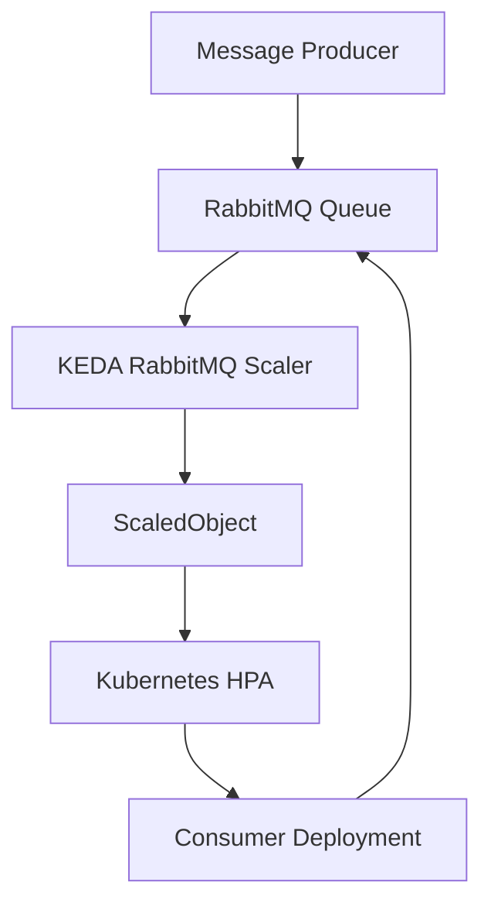

# 🚀 Kubernetes Event-Driven Autoscaling with KEDA & RabbitMQ


## 📌 Project Overview

This project explores **event-driven autoscaling in Kubernetes using KEDA (Kubernetes Event-Driven Autoscaling) and RabbitMQ**.

In traditional autoscaling, workloads are commonly scaled based on CPU and memory utilization. However, asynchronous applications often experience demand spikes based on the number of messages waiting in a queue.

This project demonstrates how KEDA can use RabbitMQ queue metrics to trigger Kubernetes workload scaling, helping applications respond to changing workloads while avoiding unnecessary idle replicas.

**Goal:** Understand and implement queue-based autoscaling while developing practical skills relevant to Site Reliability Engineering (SRE), cloud-native infrastructure, and Kubernetes operations.

## 🏗️ Architecture



### How it works

1. **Producer:** Publishes messages to a RabbitMQ queue.
2. **RabbitMQ:** Buffers incoming messages until consumers process them.
3. **KEDA:** Monitors the configured RabbitMQ queue metric.
4. **ScaledObject:** Defines the target workload and scaling trigger.
5. **Kubernetes HPA:** Adjusts the number of consumer replicas using the scaling metrics provided through KEDA.
6. **Consumer Deployment:** Processes queued messages as replicas scale up or down.

When the queue grows, the configured scaling policy can increase the number of consumers. When demand decreases, replicas can scale down to the configured minimum, potentially zero.

## 🛠️ Technology Stack

- **Kubernetes** — Container orchestration and workload management
- **KEDA** — Event-driven autoscaling
- **RabbitMQ** — Message broker and queue management
- **kubectl** — Kubernetes resource inspection and troubleshooting
- **Helm** — KEDA installation, if using the Helm-based setup
- **YAML** — Kubernetes resource and autoscaling configuration

## ✨ Key Learning Areas

- Event-driven autoscaling versus CPU-based autoscaling
- Integrating RabbitMQ with Kubernetes workloads
- Configuring KEDA `ScaledObject` resources and scaling triggers
- Understanding the relationship between KEDA and Kubernetes HPA
- Managing consumer replicas based on queue demand
- Inspecting Kubernetes events, pods, deployments, and autoscaler status
- Troubleshooting scaling configuration and queue-metric issues
- Understanding workload efficiency and scaling trade-offs

## 📋 Prerequisites

Ensure you have the following installed and configured:

- A running Kubernetes cluster, such as Minikube, Kind, or a cloud Kubernetes cluster
- `kubectl` configured to access the cluster
- Helm, if installing KEDA through Helm
- RabbitMQ deployment or a reachable RabbitMQ instance
- Basic knowledge of Kubernetes Deployments, Services, and YAML

## 🚀 Getting Started

### 1. Clone the repository

```bash
git clone https://github.com/Sadha19/k8s-project.git
cd k8s-project/keda-rabbitmq-project
```

### 2. Verify Kubernetes access

```bash
kubectl cluster-info
kubectl get nodes
```

Confirm that the cluster is reachable and the nodes are ready.

### 3. Install KEDA

If KEDA is not already installed and your project uses Helm:

```bash
helm repo add kedacore https://kedacore.github.io/charts
helm repo update

helm install keda kedacore/keda \
  --namespace keda \
  --create-namespace
```

Verify the installation:

```bash
kubectl get pods -n keda
kubectl get crd scaledobjects.keda.sh
```

If KEDA is already installed, verify its status rather than installing another release.

### 4. Deploy the project resources

Review the YAML files in the project directory and identify the manifests for RabbitMQ, the consumer application, its Service if required, and the KEDA `ScaledObject`.

Apply the relevant manifests in dependency order:

```bash
kubectl apply -f <rabbitmq-manifest.yaml>
kubectl apply -f <consumer-manifest.yaml>
kubectl apply -f <scaledobject-manifest.yaml>
```

Replace the example filenames with the actual filenames in this repository. Apply any required Secrets, ConfigMaps, and Services as well.

### 5. Verify deployed resources

```bash
kubectl get pods -A
kubectl get deployments
kubectl get services
kubectl get scaledobjects -A
kubectl get hpa -A
```

Check that RabbitMQ is reachable, the consumer workload is healthy, and the KEDA scaling resource has been created successfully.

### 6. Observe autoscaling

Monitor consumer replicas:

```bash
kubectl get deployments -w
```

Monitor pods:

```bash
kubectl get pods -w
```

Inspect the autoscaler:

```bash
kubectl describe scaledobject <scaledobject-name>
kubectl describe hpa <hpa-name>
```

Generate or publish messages using the producer or test procedure provided by the project. Observe whether the consumer replicas change according to the configured queue threshold and scaling limits.

After the queue drains, observe scale-down behavior. Scale-to-zero depends on the configured minimum replica count and the trigger configuration.

## 🔍 Troubleshooting

| Issue | What to investigate |
|---|---|
| KEDA pods are not ready | Inspect KEDA pod logs, events, and installation status |
| ScaledObject is not ready | Check its conditions, trigger configuration, and authentication |
| Queue metrics are unavailable | Verify RabbitMQ connectivity, queue name, virtual host, and credentials |
| Consumer pods are not scaling | Inspect KEDA logs, HPA status, queue depth, and scaling thresholds |
| Consumer pods are failing | Inspect pod events, container logs, resource limits, and application configuration |
| Replicas do not scale down | Check queue depth, minimum replicas, cooldown settings, and remaining workload activity |

Useful commands:

```bash
kubectl get events -A --sort-by=.lastTimestamp
kubectl describe pods <pod-name>
kubectl logs <pod-name>
kubectl logs -n keda deployment/keda-operator
kubectl describe scaledobject <scaledobject-name>
kubectl get hpa -A
```

Use the actual namespace and resource names from your cluster.

## 📈 SRE Perspective

This project provides hands-on practice with concepts that matter in reliable, scalable distributed systems.

**Reliability**
- Inspect workload health and Kubernetes events.
- Identify configuration and connectivity problems.
- Understand how queue backlogs can affect application responsiveness.

**Scalability**
- Use queue demand as an autoscaling signal.
- Understand scale-up, scale-down, replica limits, and scaling thresholds.
- Explore how asynchronous workloads respond to bursts of incoming traffic.

**Operational efficiency**
- Reduce unnecessary idle consumer replicas when the workload permits.
- Understand the trade-offs between scaling latency, processing capacity, and resource usage.

**Observability and troubleshooting**
- Use `kubectl` to inspect workload status, events, logs, and HPA conditions.
- Identify where to investigate when scaling does not behave as expected.

## 🧪 Suggested Validation Scenarios

Use these scenarios to validate and document the project:

1. **Baseline:** Confirm the consumer workload and RabbitMQ are healthy with an empty queue.
2. **Traffic spike:** Publish a batch of messages and observe queue depth and consumer replica changes.
3. **Queue drain:** Allow consumers to process messages and observe scale-down behavior.
4. **Scaling limits:** Test the configured minimum and maximum replica counts.
5. **Failure investigation:** Test a controlled configuration or connectivity failure in a non-production environment and document the observed symptoms and recovery steps.

Record actual replica counts, queue depth, scaling latency, and recovery observations before claiming performance improvements.

## 🔐 Security Considerations

- Store RabbitMQ credentials in Kubernetes Secrets or an appropriate external secrets manager.
- Do not commit passwords, tokens, or production connection strings to GitHub.
- Use least-privilege access for RabbitMQ and Kubernetes service accounts.
- Apply appropriate network restrictions and TLS where required.
- Use a non-production cluster for failure testing.

## 🎯 Future Improvements

- Add Prometheus metrics and Grafana dashboards.
- Track queue depth, consumer replicas, processing rate, and message-processing latency.
- Add alerting for sustained queue backlogs and unhealthy consumers.
- Add automated deployment and validation through a CI/CD pipeline.
- Test resilience during RabbitMQ or consumer failures.
- Document measured scaling behavior and recovery objectives.

## 📚 References

- [KEDA Documentation](https://keda.sh/docs/)
- [KEDA RabbitMQ Queue Scaler](https://keda.sh/docs/latest/scalers/rabbitmq-queue/)
- [Kubernetes Horizontal Pod Autoscaling](https://kubernetes.io/docs/tasks/run-application/horizontal-pod-autoscale/)
- [RabbitMQ Documentation](https://www.rabbitmq.com/docs)

## 👨‍💻 Author

**Sadha Sivam**

Aspiring Site Reliability Engineer | Kubernetes | Cloud & DevOps | Automation

- GitHub: [Sadha19](https://github.com/Sadha19)
- Project Repository: [KEDA RabbitMQ Autoscaling](https://github.com/Sadha19/k8s-project/tree/main/keda-rabbitmq-project)

---

⭐ If you find this project useful, feel free to explore the repository and share your feedback.

*Built as a hands-on learning project to strengthen my Kubernetes, autoscaling, troubleshooting, and SRE skills.*
