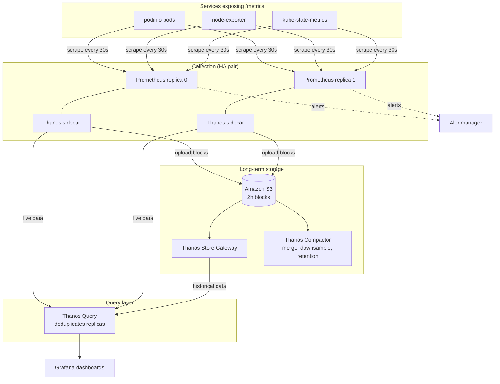

# Kubernetes Metrics Pipeline on AWS EKS

A highly available, long-retention metrics platform on Amazon EKS. Two Prometheus replicas scrape the same targets, Thanos provides a unified query layer and long-term storage in Amazon S3, and Grafana visualizes everything through a single endpoint.

Built as an SRE portfolio project to demonstrate production-style observability: HA monitoring, durable long-term storage, least-privilege AWS access, and verified failure recovery.

---

## The problem

A single Prometheus server on Kubernetes has four limitations that matter in production:

| Problem | What it means in practice |
|---|---|
| **Limited retention** | Prometheus stores data on local disk. Keeping months of history means large, expensive volumes that are hard to resize. |
| **Single point of failure** | If the one Prometheus pod restarts or its node fails, metrics stop and gaps appear in dashboards and alerts. |
| **No global view** | Each Prometheus only knows its own data. Querying across replicas, clusters, or regions needs manual work. |
| **Expensive or fragile backups** | Copying TSDB files around is error-prone, and restoring them is slow. |

This project solves all four with a design that separates **collection** (Prometheus), **storage** (S3), and **query** (Thanos), so each can fail or scale independently.

---

## Architecture



### Data flow

1. Prometheus replicas scrape the same targets independently, so each target is recorded twice. This is deliberate: if one replica is down, the other still has the data.
2. Each Thanos sidecar exposes its replica's recent data over gRPC and uploads completed 2-hour blocks to S3.
3. The Store Gateway reads blocks from S3 and serves historical queries.
4. The Compactor (a single instance) merges blocks, applies retention, and downsamples old data.
5. Thanos Query fans out each request to the sidecars and the Store Gateway, then removes duplicate series from the two replicas using the `prometheus_replica` label.
6. Grafana connects only to Thanos Query, so it sees one continuous timeline regardless of where the data lives.

### Components

| Component | Runs as | Why it's here |
|---|---|---|
| Prometheus (x2) | StatefulSet via Prometheus Operator | Collects metrics. Two replicas remove the single point of failure. |
| Thanos sidecar | Container in each Prometheus pod | Uploads blocks to S3 and exposes live data to Query. Needs no changes to Prometheus itself. |
| Thanos Query | Deployment (x2) | One query endpoint that merges and deduplicates all sources. Stateless, so it scales easily. |
| Thanos Store Gateway | StatefulSet (x1) | Serves historical data directly from S3, so Prometheus does not need to keep months of data. |
| Thanos Compactor | StatefulSet (x1, must stay at 1) | Keeps S3 data tidy: merges small blocks, downsamples old data, enforces retention. |
| Grafana | Deployment via kube-prometheus-stack | Dashboards for humans. Reads from Thanos Query only. |
| Alertmanager | StatefulSet via kube-prometheus-stack | Receives alerts from Prometheus. |
| Amazon S3 | Bucket with encryption, versioning, and private access | Durable, cheap long-term storage that is independent of the cluster. |
| IRSA | IAM role bound to Kubernetes service accounts | Gives pods S3 access without static AWS keys. |

---

## Why each design decision was made

**Two Prometheus replicas instead of one.** A single instance means a pod restart creates a gap in every graph and alert. Two replicas scraping the same targets keep data flowing when one fails. The price is double the storage for live data, which is small because S3 holds the history.

**Thanos sidecar instead of remote write.** The sidecar uploads Prometheus's own blocks and needs no change to how Prometheus collects data. Remote write is an alternative, but it sends every sample over the network as it arrives, and it does not give you the replica-aware deduplication Thanos Query provides out of the box.

**Amazon S3 for history.** S3 is durable (11 nines), cheap per GB, and decoupled from the cluster. You can delete the entire EKS cluster and still query the old blocks after rebuilding it. This is the property that makes the design resilient.

**Store Gateway instead of loading everything locally.** Without it, historical queries would need data on Prometheus's disk. The Store Gateway reads only the parts of S3 a query needs, and it keeps a small index cache.

**A single Compactor.** Compaction rewrites blocks in S3. Two compactors running at once would corrupt the bucket, so the StatefulSet stays at one replica.

**IRSA instead of access keys.** Each component gets short-lived credentials through its own service account, scoped to one bucket. No `AWS_ACCESS_KEY_ID` exists anywhere in the cluster or in git.

**Spot instances for worker nodes.** This is a lab, and the design tolerates node loss. Pods reschedule, EBS volumes reattach, and the S3 data is unaffected. Spot pricing makes the project cheap enough to rebuild often.

---

## Repository layout

```text
obs-eks/
├── eks/
│   └── cluster.yaml              # eksctl cluster definition (VPC, nodes, OIDC, addons)
├── helm/
│   └── kps-values.yaml           # kube-prometheus-stack values (Prometheus, Grafana, Thanos sidecar)
├── iam/
│   ├── thanos-s3-policy.json     # Least-privilege S3 policy for this bucket only
│   ├── lifecycle.json            # Expires old noncurrent S3 object versions
│   └── objstore.yml              # Thanos object storage config (no credentials)
├── k8s/
│   ├── storageclass-gp3.yaml     # Default gp3 StorageClass for PVCs
│   ├── sidecar-discovery.yaml    # Headless service for sidecar gRPC discovery
│   ├── thanos-query.yaml         # Thanos Query deployment and service
│   ├── thanos-store.yaml         # Store Gateway StatefulSet and headless service
│   ├── thanos-compactor.yaml     # Compactor StatefulSet and service
│   ├── thanos-servicemonitor.yaml # Scrapes Query, Store, and Compactor metrics
│   ├── sample-app.yaml           # podinfo test workload with ServiceMonitor
│   └── alerts.yaml               # PrometheusRule for pipeline health
└── README.md
```

---

## Prerequisites

- AWS account with permissions for EKS, EC2, IAM, CloudFormation, and S3 (use a sandbox account)
- AWS CLI v2, `eksctl`, `kubectl`, and Helm 3.14+
- An AWS region (this project uses `ap-south-1`)
- Budget alert set up in AWS Billing before you start

---

## Deployment order

Full step-by-step instructions were developed during the build. In summary:

1. **Cluster:** `eksctl create cluster -f eks/cluster.yaml`, with OIDC enabled.
2. **Storage:** Apply `k8s/storageclass-gp3.yaml` and make `gp3` the default.
3. **S3 bucket:** Create a private, encrypted, versioned bucket, and attach `iam/lifecycle.json`.
4. **IAM and IRSA:** Create the policy from `iam/thanos-s3-policy.json`, then bind it to the `prometheus-sa` and `thanos-sa` service accounts with `eksctl create iamserviceaccount`.
5. **Object store secret:** Create `thanos-objstore-config` from `iam/objstore.yml`. It holds bucket details only, never keys.
6. **Grafana secret:** Create `grafana-admin` in the namespace. Never put the password in a values file.
7. **Prometheus and Grafana:** `helm upgrade --install kps prometheus-community/kube-prometheus-stack -n monitoring -f helm/kps-values.yaml`
8. **Thanos components:** Apply the discovery service, Store Gateway, Compactor, and Query manifests from `k8s/`.
9. **Monitoring the monitoring:** Apply `k8s/thanos-servicemonitor.yaml` and `k8s/alerts.yaml`.
10. **Sample workload:** Apply `k8s/sample-app.yaml`, then verify.

---

## Verification

Tests were run in this order: health, scrape targets, sidecar uploads, store gateway and historical reads, deduplication, Grafana, failover, alerting, compactor behavior, and security checks.

| Area | What was verified | Result |
|---|---|---|
| Health | All pods Running, nodes Ready | Pass |
| Uploads | `thanos_shipper_uploads_total` > 0, failures = 0 | Pass |
| Historical reads | Store Gateway serves blocks from S3 | Pass |
| Deduplication | `up{job="podinfo"}` returns 3 series, not 6 | Pass |
| Failover | Prometheus pod deletion leaves graphs continuous | Pass |
| Alerting | `ThanosQueryDown` moves to Firing when Query is scaled to zero | Pass |
| Security | No static keys, private bucket, encryption enabled | Pass |

Add screenshots of the Loaded Blocks page, the deduplicated query, the failover graph, and the firing alert under `docs/` if you want them visible in the repo.

---

## Issues encountered and how they were fixed

These are the problems that came up during the build, and they are the most useful part of this project to discuss in interviews.

**Thanos containers could not write to the EBS volume.** The Thanos images run as a non-root user, but the EBS volume was owned by root, which caused `mkdir /data/meta-syncer: permission denied`. **Fix:** set `fsGroup: 65534` in the pod security context so Kubernetes grants group access to the mounted volume.

**Helm silently ignored the Thanos object storage setting.** The `objectStorageConfig` values were nested one level too shallow, so the chart rendered the Prometheus object without the bucket reference. The sidecar then started with "no supported bucket was configured" and uploaded nothing. **Fix:** nest `name` and `key` under `existingSecret`, and verify the rendered result with `kubectl get prometheus -o jsonpath` before assuming it worked.

**Sidecar metrics were not visible in Prometheus.** The `thanosService` and `thanosServiceMonitor` keys must sit at the `prometheus:` level, not under `prometheusSpec`. Helm accepted the wrong placement without any error. **Fix:** check the chart's own values output for indentation before editing.

**Alert expressions that referenced unscraped jobs would never fire.** An alert on a metric with no series is silent. **Fix:** add ServiceMonitors for every Thanos component and wrap counts with `or vector(0)` so "no data" evaluates to a failure.

**The Grafana password was in a values file.** **Fix:** store it in a Kubernetes secret and reference it with `existingSecret`.

---

## Security notes

- No AWS access keys exist in the cluster or in git. All S3 access uses IRSA.
- The S3 bucket blocks all public access, uses SSE-S3 encryption, and has a lifecycle rule for old versions.
- The IAM policy is scoped to one bucket.
- Grafana credentials live in a Kubernetes secret, not in the repo.
- Before publishing, replace the AWS account ID, role ARNs, and bucket name in `helm/kps-values.yaml` and `iam/` with placeholders.

---

## Cost

Estimated cost in `ap-south-1` while running: about $5 to $6 per day with two Spot worker nodes, one NAT gateway, and about 80 GB of gp3 storage. The EKS control plane is the fixed cost. Tear the cluster down when not in use. The S3 bucket costs very little to keep, and it allows historical data to survive a cluster rebuild.

To tear down:

```bash
kubectl -n monitoring delete pvc --all
helm -n monitoring uninstall kps
eksctl delete cluster --name obs-eks --region ap-south-1
```

---

## Possible next steps

- Add Alertmanager receivers (Slack or email) so alerts leave the cluster.
- Move Helm values into a GitOps tool such as Argo CD.
- Add Thanos Ruler for recording and alerting rules that query the full history.
- Enable the Compactor's `--deduplication.replica-label` flag to merge the replicas in storage.
- Add a second cluster with its own sidecars to show multi-cluster querying through one Thanos Query.
- Put Grafana behind an ALB with SSO instead of port-forwarding.
